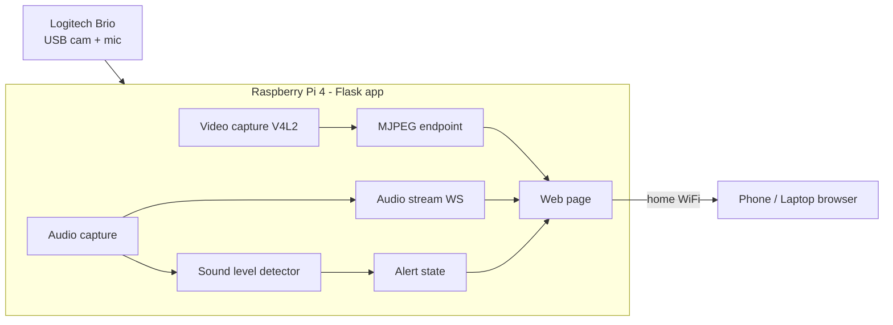

# Implementation Plan — Raspberry Pi Baby Monitor (POC)

> **Active investigation:** Task 4's live video stream has a latency problem
> (>1 min lag) and intermittent crash/recover of the camera feed. See
> [`plans/VIDEO_STREAM_DEBUG.md`](VIDEO_STREAM_DEBUG.md) for the debug plan
> (what to investigate + findings) and the resulting fix strategy. This should
> be resolved before Task 7 (robustness), which depends on a stable feed.

## Problem Statement
Build a proof-of-concept baby monitor on an existing Raspberry Pi 4 Model B (2GB) that streams live video + audio to a web browser over the local WiFi network. The POC should also demonstrate cry/sound detection alerts. It uses a Logitech Brio USB webcam for the POC, with a clear upgrade path to a dedicated day/night (IR) camera later.

## Requirements
- Live audio + video streaming, viewable by opening a web page on phone/laptop (local network only).
- Hardware: Raspberry Pi 4 Model B (2GB), Logitech Brio USB webcam (video + mic) for the POC.
- Custom Python (Flask) app so features can be added incrementally.
- Stretch feature: cry/sound detection alert; future feature: recording/snapshots.
- Success criterion: reliably see + hear the baby from another room over home WiFi.
- Recommended addition: run unattended (auto-start at boot).
- Future hardware: dedicated day + night vision (IR) camera.
- Dev environment: flashing and development from a macOS machine; SSH to the Pi.

## Background / Research Findings
- **Streaming choice:** MJPEG streaming works in any browser via a simple `` tag, is easy to serve from Flask, and gives acceptable latency (~0.5–2s) — ideal for a POC. WebRTC gives sub-second latency (~200–700ms) but is much more complex; noted as a future upgrade.
- **Audio:** Browsers can't natively play a raw mic feed as trivially as MJPEG video. Pragmatic POC approach is to stream audio over WebSocket (capture on the Pi, play in-browser via the Web Audio API).
- **Cry detection:** Start simple — compute audio RMS/volume level and fire an alert when it crosses a threshold for a sustained period (with hysteresis). Proves feasibility before investing in ML-based cry classification.
- **Night vision (future):** NoIR cameras + IR LEDs, ideally with an automatic motorized IR-CUT filter (e.g., Arducam OV5647 Motorized IR-CUT on the CSI port, or Camera Module 3 NoIR + IR LEDs). POC uses the Brio, so this is documented as a later swap.
- **Tooling on Pi:** libcamera/V4L2 for capture, OpenCV or direct V4L2 for USB webcam frames, sounddevice/pyaudio for audio, Flask for the web layer, systemd for auto-start.

## Proposed Solution
A single Python Flask application on the Pi that:
1. Captures video frames from the Brio (USB/V4L2) and serves them as an MJPEG stream.
2. Serves a simple web page with video and status.
3. Captures audio from the Brio mic and streams it to the browser.
4. Analyzes audio levels for a cry/sound-detection alert shown in the UI.
5. Runs automatically at boot via systemd.

## Task Breakdown

### Task 1: Flash and configure the Raspberry Pi OS
- **Objective:** Get the Pi 4 running a fresh OS on its SD card, connected to WiFi, and reachable over the network for headless development.
- **Guidance:**
  - Use the official Raspberry Pi Imager (macOS) to flash Raspberry Pi OS (64-bit); Lite is sufficient for a headless monitor.
  - In the Imager's OS customization settings preconfigure: hostname (e.g., `babymonitor`), enable SSH, WiFi SSID + password, locale/timezone.
  - Boot the Pi, confirm reachability via `ping babymonitor.local` and connect over SSH (`ssh <user>@babymonitor.local`).
  - Run `sudo apt update && sudo apt full-upgrade`; install baseline tooling (Python 3, pip, venv, git). Note the Pi's LAN IP.
- **Test:** SSH into the Pi from the Mac; confirm WiFi + internet and Python 3 availability.
- **Demo:** From the Mac, SSH into the freshly flashed Pi over WiFi — online, updated, ready to develop on.

### Task 2: Project skeleton + Flask "hello" page
- **Objective:** Set up a Python project (venv, requirements, Flask app) serving a single web page at the Pi's IP.
- **Guidance:** Create project structure, pin dependencies, minimal `app.py` and one HTML template. Confirm the Pi's LAN IP.
- **Test:** From a phone/laptop on the same WiFi, load `http://<pi-ip>:<port>/` and see the page.
- **Demo:** A blank "Baby Monitor" web page loads on another device over WiFi.

### Task 3: Detect and validate the Brio camera + mic
- **Objective:** Confirm the OS sees the Brio's video and audio devices and can capture from them.
- **Guidance:** Enumerate V4L2 video devices and ALSA audio inputs; write a small diagnostic reporting resolution/formats and capturing a test frame + short audio sample.
- **Test:** Diagnostic prints the Brio video node and audio device and grabs one frame and one audio buffer.
- **Demo:** Run the diagnostic; it reports the detected Brio and saves a single test snapshot.

### Task 4: Live MJPEG video stream in the browser
- **Objective:** Stream Brio video to the web page as MJPEG.
- **Guidance:** Add a background capture loop and a `/video_feed` multipart MJPEG endpoint; embed via an `` tag. Configurable resolution/frame rate to keep the Pi 4 comfortable.
- **Test:** Frames update continuously; stream survives client disconnect/reconnect.
- **Demo:** Open the page on the phone and see live video of the room.

### Task 5: Live audio stream in the browser
- **Objective:** Capture Brio mic audio and play it in the browser alongside the video.
- **Guidance:** Capture audio buffers, stream to the browser via WebSocket + Web Audio API playback. Address buffering vs. latency tradeoff.
- **Test:** Make a sound near the Pi; confirm audible in the browser within acceptable delay.
- **Demo:** On the phone you both see AND hear the room live.

### Task 6: Sound-level cry detection alert
- **Objective:** Analyze incoming audio and raise an alert when volume exceeds a threshold for a sustained duration.
- **Guidance:** Compute RMS/volume from captured audio buffers; add hysteresis/time-window so brief noises don't trigger. Expose alert state to the UI (visual banner + optional browser notification/sound).
- **Test:** Play a loud/crying sound and confirm the alert fires; confirm quiet background does not; tune threshold.
- **Demo:** When someone makes a sustained loud noise, the web page shows a "Sound detected" alert.

### Task 7: Robustness + status UI
- **Objective:** Make the stream resilient and give clear at-a-glance status.
- **Guidance:** Auto-recover if capture drops; show connection/health status and current sound level; handle multiple viewers gracefully.
- **Test:** Unplug/replug scenarios and multi-device viewing; app recovers without manual restart.
- **Demo:** View from two devices at once; briefly interrupt capture and watch it recover automatically.

### Task 8: Auto-start at boot (run unattended)
- **Objective:** Launch the monitor automatically on power-up.
- **Guidance:** Create a systemd service that starts the Flask app at boot, restarts on failure, and starts after the network is up.
- **Test:** Reboot the Pi with only power connected; confirm the stream is live from another device with no manual step.
- **Demo:** Power-cycle the Pi, wait, open the page on the phone — video + audio + alerts live with zero interaction.

### Task 9: Night-vision upgrade path (documentation only)
- **Objective:** Document how to swap the Brio for a day/night IR camera later without rearchitecting.
- **Guidance:** Note recommended cameras (Arducam OV5647 Motorized IR-CUT on CSI, or Camera Module 3 NoIR + IR LEDs), how libcamera/V4L2 capture would change, and auto IR-CUT switching behavior. No code changes in the POC.
- **Test:** N/A (docs).
- **Demo:** A short README section describing exact parts and code touch-points for adding night vision.
